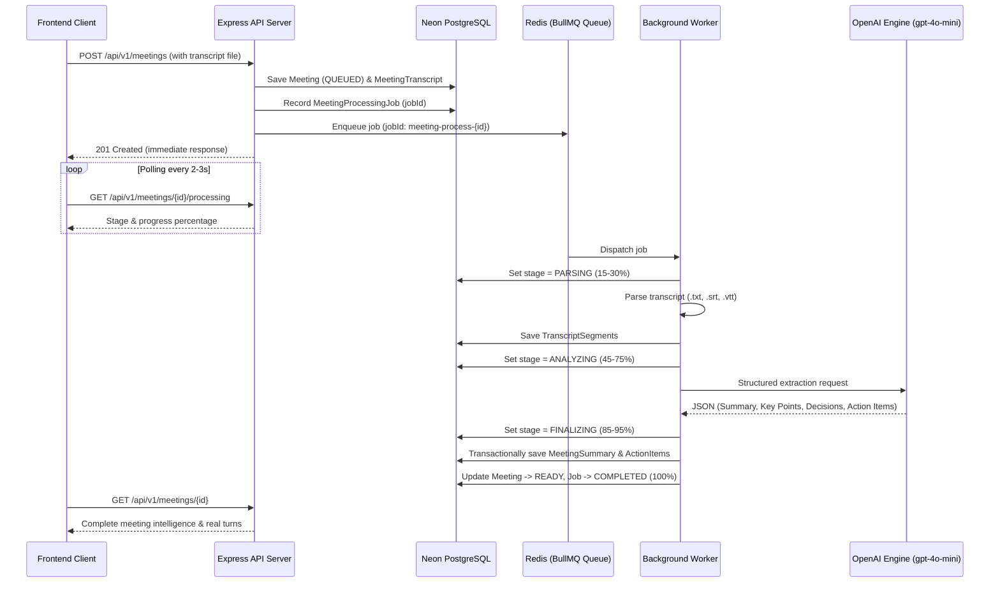

# Background Meeting Intelligence & Queue Processing Architecture

## 1. High-Level Flow

MeetFlow AI processes meeting transcripts asynchronously using **BullMQ**, **Redis**, and a dedicated worker process, with **Neon PostgreSQL** serving as the durable source of truth.



---

## 2. Queue Reliability & Idempotency Principles

1. **Decoupled Enqueue Strategy**:
   The meeting and raw transcript text are durably committed to Neon before queueing. If Redis is temporarily unreachable, the meeting remains in Neon marked as `QUEUED` and can be retried or reconciled without losing user uploads.

2. **Deduplication & Concurrency**:
   - Jobs use a deterministic `jobId: meeting-process-${meetingId}`.
   - Concurrency is throttled to prevent rate-limit flooding against OpenAI.
   - Exponential backoff retries transient network or rate-limit errors up to 3 times.

3. **Reprocessing & Preserving User State**:
   - Re-running analysis overwrites or refreshes the AI summary and transcript segments cleanly.
   - For action items: tasks that the user has already touched or marked `DONE`/`IN_PROGRESS` are strictly preserved and never overwritten.
   - Retrying does not generate duplicate tasks.

---

## 3. Worker Execution & Development Setup

To run the background worker alongside the Express API and Dashboard:
```bash
# Terminal 1: Express API Server
pnpm dev:api

# Terminal 2: Vite Dashboard
pnpm dev:dashboard

# Terminal 3: BullMQ Worker
pnpm dev:worker
```
